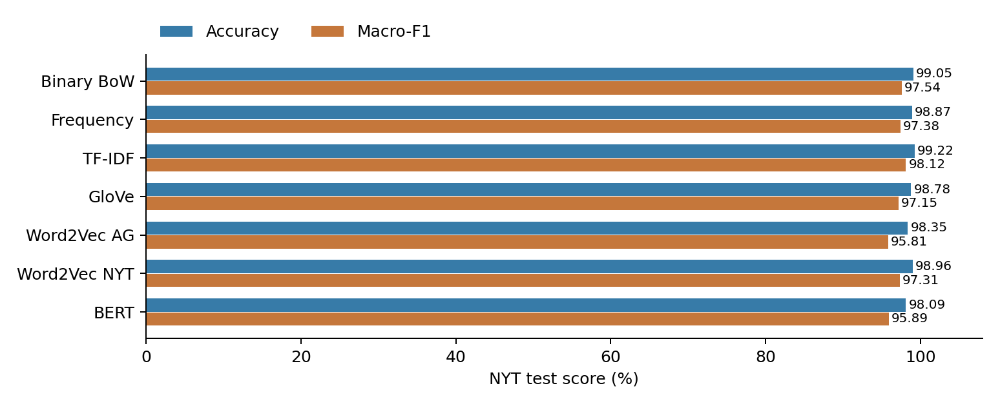
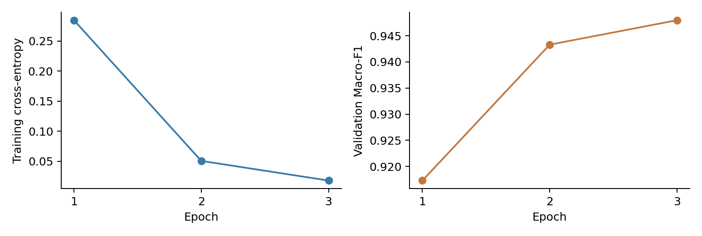
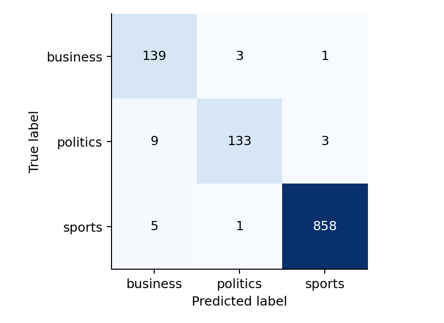

# NYT 新闻文本分类实验报告

NYT 新闻文本分类实验报告

作业一  |  词袋表示、词向量与 BERT 微调

本实验使用同一 NYT 测试集比较七种方法。此次单次实验中，TF-IDF 的测试 Macro-F1 最高，为 0.9812，Accuracy 为 0.9922。全部结果来自实际训练；每条测试预测、划分行号和运行参数均随仓库保存。

## 一 数据与实验范围

NYT 共 11,519 篇新闻，包含 business、politics、sports 三类；AG News 共 90,000 篇，仅用于训练其中一组 Word2Vec。固定随机种子 42，以分层随机方式打乱并按约 80% / 10% / 10% 划分。

| 集合 | business | politics | sports | 总数 |
| --- | --- | --- | --- | --- |
| 训练 | 1143 | 1161 | 6911 | 9215 |
| 验证 | 143 | 145 | 864 | 1152 |
| 测试 | 143 | 145 | 864 | 1152 |

类别明显不平衡。仅预测 sports 的基线 Accuracy 为 0.7500，Macro-F1 为 0.2857。因此主要依据 Macro-F1 比较对少数类别的识别能力，同时报告 Accuracy。

要求说明：Task 1 总述写“三种”，但正文只列出 Binary 和 Word Frequency。本实验完成这两项，并补充 TF-IDF 作为第三种；此项属于对原文歧义的明确实现选择。

原 NYT 中有 72 条重复文本记录。保持原始样本开展规定的随机划分，并单独审计跨集合重复，避免隐瞒可能造成的乐观偏差。

## 二 表示方法与训练设置

词袋与词向量实验使用同一分词规则：转为小写，提取英文词并保留词内撇号，不移除停用词。BERT 则使用其预训练 WordPiece tokenizer。Accuracy 是正确预测比例；Macro-F1 是三个类别各自 F1 的算术平均，零分母按 0 处理。

| 方法 | 文档表示与参数 |
| --- | --- |
| Binary BoW | 词出现则为 1，否则为 0。完整训练集词表。 |
| Word Frequency | 记录每个词在文档中的出现次数，不进行长度归一化。 |
| TF-IDF | tf × [log((1+N)/(1+df))+1]，随后做文档 L2 归一化。 |
| GloVe | Stanford glove.6B.100d，400,000 个词，100 维预训练词向量。 |
| Word2Vec AG | 全部 AG 文本；Skip-gram，100 维，窗口 5，负采样 5。 |
| Word2Vec NYT | 仅 NYT 训练集文本；与 AG 模型使用相同参数。 |

两组 Word2Vec 最低词频为 5，训练 10 轮；使用单 worker、固定种子和稳定词哈希。词向量方法对文档内所有有效词向量取算术平均，重复出现的词重复计入；跳过 OOV，全 OOV 文档使用零向量。100 维特征标准化仅在训练集上拟合。

六组传统方法统一使用 Logistic Regression（L2 正则，lbfgs，最多 3000 次迭代）。在 C={0.1,1,10} 中只依据验证 Macro-F1 选择，平局取较小 C；所选模型仅训练于训练集，不再合并验证集。词表、IDF、标准化和 NYT Word2Vec 都不拟合验证或测试文本。

| 方法 | 词表或向量维数 | 所选 C | 验证 Macro-F1 |
| --- | --- | --- | --- |
| Binary BoW | 64285 | 1.0 | 0.9635 |
| Frequency | 64285 | 0.1 | 0.9591 |
| TF-IDF | 64285 | 10.0 | 0.9639 |
| GloVe | 100 | 0.1 | 0.9523 |
| Word2Vec AG | 100 | 0.1 | 0.9465 |
| Word2Vec NYT | 100 | 1.0 | 0.9632 |

BERT 使用 google-bert/bert-base-uncased，全参数微调。max_length=64（含特殊 token），完整训练 3 轮；批量 16、累积 2、AdamW 学习率 2e-5、权重衰减 0.01、10% warmup 后线性衰减、梯度裁剪 1.0。bias 与 LayerNorm 权重不做衰减。CUDA 上使用 FP16。

## 三 统一测试集结果

| 方法 | Accuracy | Macro-F1 | 运行秒数 |
| --- | --- | --- | --- |
| Binary BoW | 0.9905 | 0.9754 | 6.9 |
| Frequency | 0.9887 | 0.9738 | 17.1 |
| TF-IDF | 0.9922 | 0.9812 | 7.5 |
| GloVe | 0.9878 | 0.9715 | 11.7 |
| Word2Vec AG | 0.9835 | 0.9581 | 147.3 |
| Word2Vec NYT | 0.9896 | 0.9731 | 224.3 |
| BERT | 0.9809 | 0.9589 | 218.8 |

运行时间包括各方法特征构建、训练、验证和预测等步骤，不含预训练资源下载。部分任务并行运行，且硬件与模型结构不同，因此时间仅描述本次运行，不作为严格速度基准。

传统方法中 TF-IDF 的测试 Macro-F1 最高。BERT 与它的差值为 -0.0223。这是固定种子下的描述性比较，未进行多种子重复或显著性检验，不能据此断言某方法在所有数据上更好。

词袋模型保留直接区分类别的关键词；TF-IDF 降低常见词权重。平均词向量压缩到 100 维，能利用词之间的语义联系，但丢失词序，也可能稀释少数关键句。BERT 建模上下文，不过本作业只允许 64 个 token，长新闻的后续信息会被截断。

## 四 词向量覆盖与 BERT 训练

| 词向量 | 训练 token 覆盖率 | 测试 token 覆盖率 | 测试全 OOV 文档 |
| --- | --- | --- | --- |
| GloVe | 98.13% | 98.12% | 0 |
| Word2Vec AG | 95.78% | 95.78% | 0 |
| Word2Vec NYT | 98.91% | 98.51% | 0 |

AG Word2Vec 与 NYT Word2Vec 的测试 Macro-F1 分别为 0.9581 和 0.9731。领域、语料长度与规模、词覆盖和低频词过滤同时变化，因此性能差异不能单独归因于“同领域”这一因素。覆盖率按词出现次数计算，而非不同词类型数量。

| Epoch | 训练平均损失 | 验证 Macro-F1 |
| --- | --- | --- |
| 1 | 0.2847 | 0.9173 |
| 2 | 0.0506 | 0.9433 |
| 3 | 0.0179 | 0.9480 |

BERT 完成三轮训练后，依据验证 Macro-F1 选取第 3 轮 checkpoint。测试集不参与轮次选择。完整曲线数据保存在 results/bert_history.json。

由于模型只观察新闻开头，标题和导语可能携带较强类别信号，但有关截断影响的判断属于解释性假设；本实验未增加长序列对照，不能量化其因果影响。

## 五 分类误差与重复文本审计

| 类别 | Precision | Recall | F1 | 样本数 |
| --- | --- | --- | --- | --- |
| business | 0.9085 | 0.9720 | 0.9392 | 143 |
| politics | 0.9708 | 0.9172 | 0.9433 | 145 |
| sports | 0.9954 | 0.9931 | 0.9942 | 864 |

完全相同文本的交集数量：训练/验证 14，训练/测试 10，验证/测试 1（计不同文本数）。AG 与 NYT 的完全相同文本交集为 0。这些统计不涵盖改写或近重复新闻。

补充敏感性检查：排除与训练集文本完全相同的测试记录后，保留 1142 / 1152 条测试样本。以下仅重新计算已保存预测，不重新训练、不替代规定测试集主表。

| 方法 | 排重后 Accuracy | 排重后 Macro-F1 |
| --- | --- | --- |
| Binary BoW | 0.9904 | 0.9750 |
| Frequency | 0.9886 | 0.9734 |
| TF-IDF | 0.9921 | 0.9809 |
| GloVe | 0.9877 | 0.9711 |
| Word2Vec AG | 0.9834 | 0.9573 |
| Word2Vec NYT | 0.9895 | 0.9727 |
| BERT | 0.9807 | 0.9582 |

## 六 复现与结论

本次训练环境：Python 3.12.14；GPU 为 NVIDIA GeForce RTX 4060 Laptop GPU。所有结果使用同一保存划分，并通过逐条预测重算核验。

| 依赖 | 实际版本 |
| --- | --- |
| numpy | 2.2.6 |
| pandas | 2.2.3 |
| scikit-learn | 1.6.1 |
| gensim | 4.4.0 |
| torch | 2.6.0+cu124 |
| transformers | 4.51.3 |

从仓库根目录依次运行：uv sync --frozen --python 3.12；uv run --frozen python scripts/run_all.py。分步命令、CPU 选项、网络设置和文件结构详见 README.md。PDF 和 Markdown 由同一结果文件生成。

可复核证据：results/split.json 保存划分与源文件 SHA-256；各方法 JSON 保存参数、验证和测试指标、混淆矩阵；*_predictions.csv 保存原始行号、真实标签和预测标签；audit.json 保存独立指标核验及重复文本敏感性结果。预训练资源来源和 SHA-256 记录在 assets.json。

本次比较中，TF-IDF 达到最高测试 Macro-F1。结论仅适用于本数据、当前划分和给定超参数。未覆盖多随机种子、近重复去重和长文本 BERT 对照；这些是后续完善实验的方向，不作为本报告已经完成的实验。

## 参考资料

1. Stanford GloVe 项目与 glove.6B 预训练向量：https://nlp.stanford.edu/projects/glove/

2. Mikolov 等，Efficient Estimation of Word Representations in Vector Space，2013：https://arxiv.org/abs/1301.3781

3. Devlin 等，BERT: Pre-training of Deep Bidirectional Transformers for Language Understanding，NAACL 2019：https://aclanthology.org/N19-1423/

4. BERT 模型与固定权重版本：https://huggingface.co/google-bert/bert-base-uncased

5. 数据与任务定义：仓库内 HW-1/nyt.csv、HW-1/ag.csv 及 作业一要求.docx。
